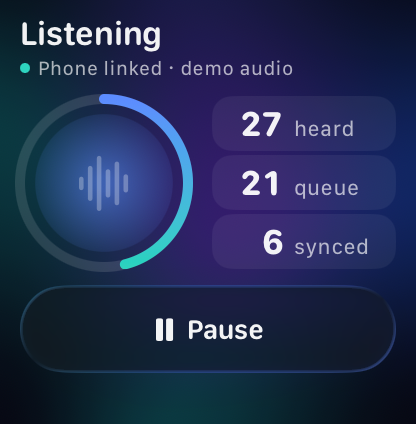
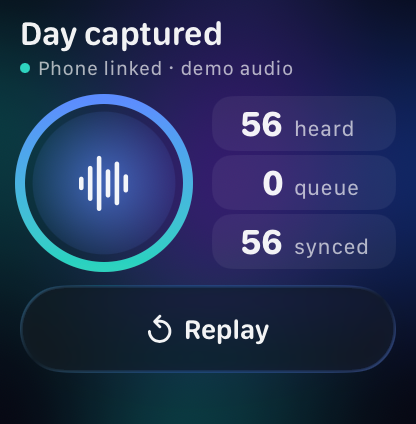
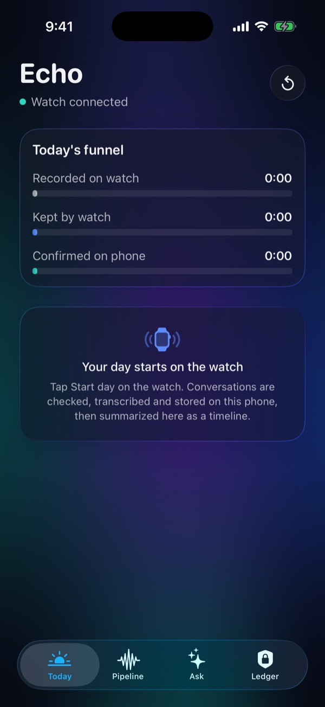
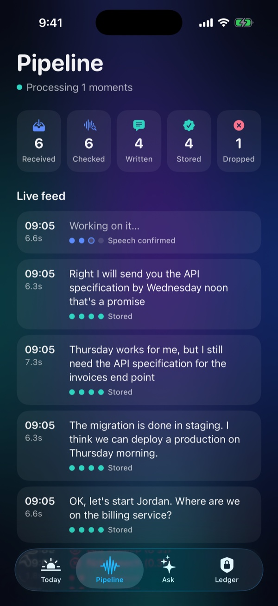
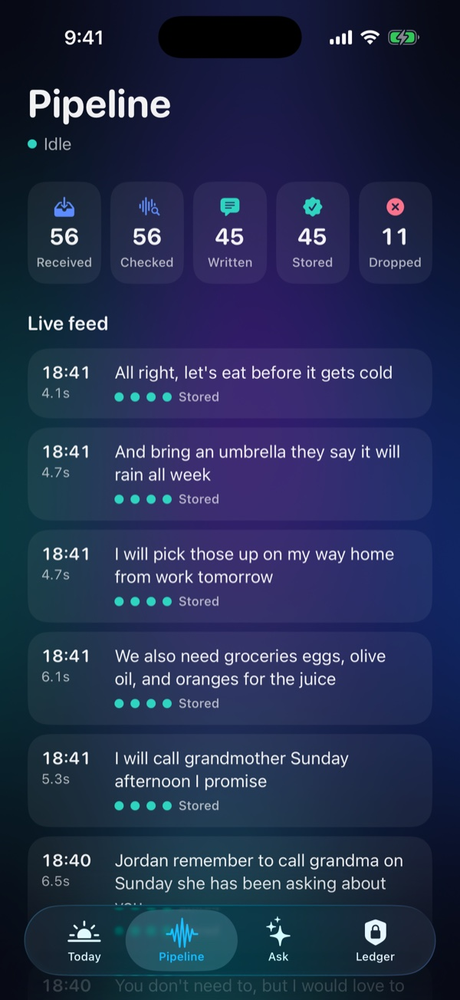
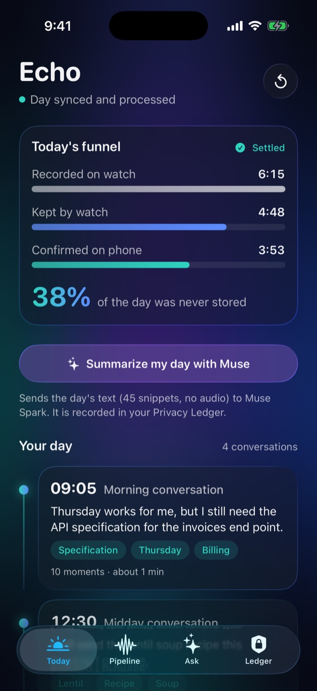
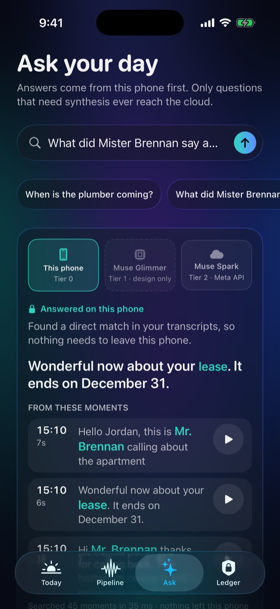
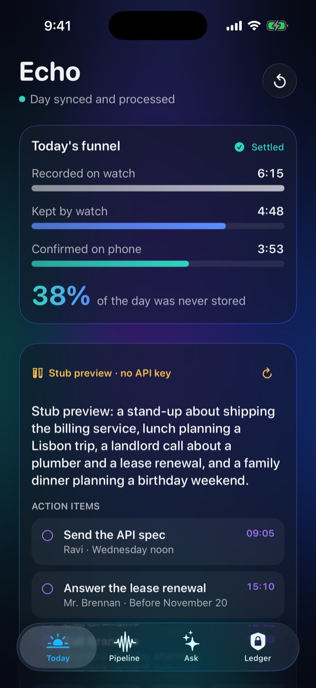
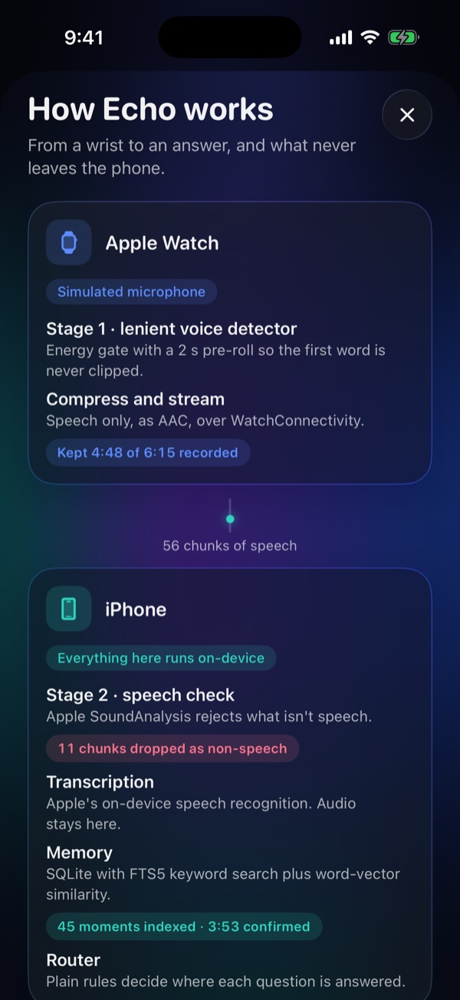

<div align="center">

# Echo

### A private memory for your day

*Your watch listens. Your phone remembers. Meta's Muse Spark helps only when it has to.*


</div>

Echo turns a day of conversations into something you can ask questions of, **without handing your voice to anyone**. The speech is transcribed and searched on your phone. Only the rare question that needs real synthesis goes to **Meta's Muse Spark**, and when it does, Echo sends a handful of text snippets, never audio, and records exactly what left the device in a privacy ledger.

> **What is real and what is simulated.** The watch and phone are Xcode simulators, and the "microphone" is a pre-recorded, synthetic-voice day replayed through the real pipeline. Everything after the microphone is real. See [What's real](#whats-real-simulated-and-design-only).

## See it work

<p align="center">
  
</p>

<p align="center">
  <a href="docs/media/echo-demo-preview.mp4"><b>▶ Watch the full-quality preview (MP4)</b></a>
</p>

<p align="center"><sub>The watch replays a day, the phone checks, transcribes and indexes it, and then questions are answered on the phone. The cloud answers in this preview come from Echo's clearly labeled <b>offline stub</b>, because no API key was configured when it was recorded. Run <code>Tools/make_readme_media.sh</code> with a key to regenerate it with live Muse answers.</sub></p>

## A tour of the screens

### Apple Watch

The watch is a silent sensor, so its screen is a proof of life: a ring that traces the replay and breathes with the microphone level, three counters, and one control.

<table align="center">
  <tr>
    <td align="center"><br><sub><b>Ready</b><br>Phone linked, demo audio</sub></td>
    <td align="center"><br><sub><b>Listening</b><br>Chunks stream to the phone</sub></td>
    <td align="center"><br><sub><b>Day captured</b><br>Everything synced</sub></td>
  </tr>
</table>

### iPhone

<table align="center">
  <tr>
    <td align="center" valign="top"><br><sub><b>First launch</b><br>A clean slate</sub></td>
    <td align="center" valign="top"><br><sub><b>Pipeline, live</b><br>Each chunk is checked, transcribed and stored</sub></td>
    <td align="center" valign="top"><br><sub><b>Pipeline, settled</b><br>Speech kept, noise dropped</sub></td>
  </tr>
  <tr>
    <td align="center" valign="top"><br><sub><b>Today</b><br>The funnel and the day as conversations</sub></td>
    <td align="center" valign="top"><br><sub><b>Ask, answered locally</b><br>Highlighted words, source audio, ~30 ms</sub></td>
    <td align="center" valign="top"><br><sub><b>Ask, another lookup</b><br>The headline is the sentence that answers</sub></td>
  </tr>
  <tr>
    <td align="center" valign="top"><br><sub><b>Ask, synthesis</b><br>Routed to Tier 2 (offline stub in this shot)</sub></td>
    <td align="center" valign="top"><br><sub><b>Day digest</b><br>Conversations, action items, people (stub in this shot)</sub></td>
    <td align="center" valign="top"><br><sub><b>Privacy ledger</b><br>What stayed, what left, the cloud switch</sub></td>
  </tr>
  <tr>
    <td align="center" valign="top" colspan="3"><br><sub><b>How Echo works</b><br>The whole system with live numbers and honesty labels</sub></td>
  </tr>
</table>

## What it does

1. **Watch.** Listens, keeps only speech (a lenient voice detector with a 2-second pre-roll so the first word is never clipped), compresses it and streams it to the phone.
2. **Phone, all on-device.** A second speech check (Apple SoundAnalysis) rejects what isn't speech, Apple's on-device recognizer transcribes it, and the text is indexed in SQLite (FTS5 keyword search plus word-vector similarity).
3. **Ask your day.** A rules-based router decides where each question is answered:
   - **Lookups** ("When is the plumber coming?") are answered on the phone in about 30 ms, with the matching words highlighted and the original audio one tap away.
   - **Synthesis** ("What did I promise people today?", "Summarize my day") goes to **Muse Spark** through the Meta Model API. Echo plans the smallest set of snippets the question needs, sends text only, and asks for a structured answer.
4. **Privacy ledger.** Every question is recorded with where it was answered, the exact text and bytes sent, tokens and latency. A switch turns the cloud off entirely.

## What's real, simulated, and design-only

| Part | Status |
|---|---|
| Voice detection on the watch, chunking, AAC compression, streaming to the phone | **Real** (running in the watchOS simulator) |
| Stage-2 speech check, on-device transcription, SQLite FTS5 + word-vector index, retriever, router, answers | **Real** |
| Muse Spark client (structured output, text-only snippets, ledger, error handling) | **Implemented** to Meta's documented API and covered by mocked-network tests. Live calls need an API key in `Config/meta_api_key.txt`; without one Echo uses a **labeled offline stub** (the screenshots above show the stub) |
| The microphone | **Simulated**: a pre-recorded day (text-to-speech voices, 4 conversations) replayed as the mic |
| Watch ↔ phone link | **Simulated hardware**: WatchConnectivity messages between two simulators |
| Muse Glimmer on-device (Tier 1) | **Design only**: shown in the UI as not available, never run |

## Architecture


## Measured on the demo day

| | |
|---|---|
| Recorded → kept by the watch → confirmed on the phone | 6:15 → 4:48 → 3:53 (38% of the day never stored) |
| Stage 2 | 45 of 45 speech chunks kept, 11 of 11 noise chunks rejected (the noise is synthetic, so this flatters it) |
| Transcription word error rate | 7.2% overall (every scene under 10%) on text-to-speech voices; it will be worse on real speech |
| Retrieval | right moment ranked first for 12 of 12 questions; median search about 26 ms |
| Tests | 75 unit tests, including a retrieval and routing eval over a fixed transcript fixture and a mocked-network suite for the Muse client |

## The privacy model

- **Audio never leaves the phone.** The cloud client's request type holds text only, and a test asserts that no audio, file name or local identifier appears in the request body.
- **Only what a question needs is sent.** Commitments send the moments that contain promises or plans; a summary sends the day; a question that matches nothing sends nothing.
- **Everything is on the record.** The Privacy Ledger lists each question, which tier answered, and the exact snippets and bytes sent. Local answers are logged with zero bytes.
- **You are in control.** One switch turns the cloud off; those questions then show the closest moments on the phone.
- **No hidden fallback.** If Muse can't be reached, Echo says so (key rejected, rate limited, timed out, offline: "nothing left your phone"). The offline stub only appears when no key exists, and it labels itself.

## How Echo uses Muse Spark

Echo calls `POST https://api.meta.ai/v1/chat/completions` with model `muse-spark-1.3`, a `developer` message with the rules, a `user` message with the question and time-labelled snippets, `reasoning_effort: "low"`, and a JSON-schema `response_format`. If the account can't use that model, the client falls back to 1.2 then 1.1; if structured output is refused, it retries once with the schema in the instructions. The answer comes back as structured data (an answer plus items with a due date and the time of the moment each came from) and is rendered as cards. The prompt tells Muse that the transcripts are noisy speech recognition, so it can reconcile slips like "Wednesday Lou" and say when it did. The same path produces the one-tap "Summarize my day" digest of conversations, action items and people.

## Run it

Requirements: macOS with Xcode 26.1.1 and the iOS 26.1 and watchOS 26.1 simulators.

```bash
# 1. Pair a phone and a watch simulator (once) and put their IDs at the top of the scripts in Tools/
xcrun simctl list devices available
xcrun simctl pair <WATCH_UDID> <PHONE_UDID>

# 2. (Optional) add your Meta Model API key. Without it Echo uses its labeled offline stub.
#    Edit Config/meta_api_key.txt and replace the placeholder line. It is gitignored.

# 3. Build, install both apps and launch
Tools/run_sims.sh --autostart      # the watch starts replaying the day immediately
```

The first launch asks for speech-recognition permission on the phone; tap Allow once. Then open **Today**, **Pipeline**, **Ask** and **Ledger**.

| Script | What it does |
|---|---|
| `Tools/demo_prep.sh` | Clean, recordable simulators (9:41 status bar, dark mode, fresh day) |
| `Tools/e2e_check.sh` | Replays the day and checks the whole demo against ground truth (PASS/FAIL) |
| `Tools/muse_smoke.sh` | Checks your API key, model and region with one tiny call |
| `Tools/check_no_secrets.sh` | Fails if your key appears anywhere it could be published |
| `Tools/make_readme_media.sh` | Regenerates the screenshots, video and GIF in this README |

```bash
# Unit tests
xcodebuild test -project Echo.xcodeproj -scheme Echo \
  -destination 'platform=iOS Simulator,name=iPhone 17 Pro' -only-testing:EchoTests
```

## Repo map

| Path | What's there |
|---|---|
| `Echo Watch App/` | Watch app: replay engine, uploader, status screen, the demo audio |
| `Echo/` | Phone app: receiver, pipeline, screens |
| `Echo/Search/` | Normalizer, embeddings, hybrid retriever, router, answer extraction |
| `Echo/Cloud/` | Muse client, planner and prompts, labeled stub, key handling |
| `Echo/Ledger/` | The privacy ledger and the cloud switch |
| `Shared/` | Code shared by both apps: voice detector, wire format, clock, theme |
| `EchoTests/` | Unit tests and the transcript fixture |
| `Tools/` | Demo audio generator, calibration, simulator, demo and media scripts |
| `docs/media/` | The screenshots, preview video, GIF and hero image above |

## Limitations and what's next

- The microphone is simulated; a real watch needs a foreground session and `AVAudioEngine`, and WatchConnectivity file transfer in place of the simulator's message transport.
- Muse Glimmer on-device (Tier 1) is a design, not an implementation.
- Retrieval uses averaged word vectors because sentence embeddings aren't available in the simulator; a sentence model would be the next upgrade. It does not use `sqlite-vec`.
- Transcription quality on real, noisy speech is untested.
- The router is rules, not a model; it is easy to explain and test, but a learned router could handle more phrasing.
