<div align="center">

# Echo

### A private memory for your day

*Your watch listens. Your phone remembers. Meta's Muse Spark helps only when it has to.*


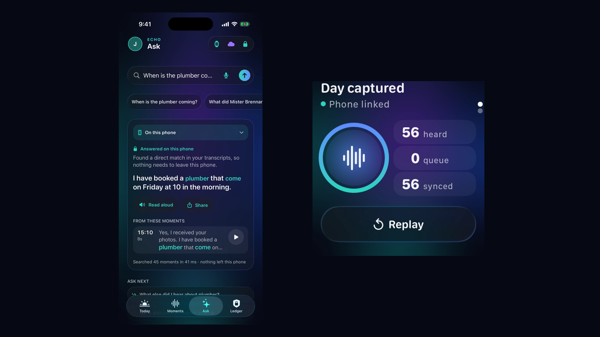

</div>

Echo turns a day of conversations into something you can ask questions of, **without handing your voice to anyone**. The speech is transcribed and searched on your phone. Only the rare question that needs real synthesis goes to **Meta's Muse Spark**, and when it does, Echo sends a handful of text snippets, never audio, and records exactly what left the device in a privacy ledger.

> **What is real and what is simulated.** The watch and phone are Xcode simulators, and the "microphone" is a pre-recorded, synthetic-voice day replayed through the real pipeline. Everything after the microphone is real. See [What's real](#whats-real-simulated-and-design-only).

## See it work

<p align="center">
  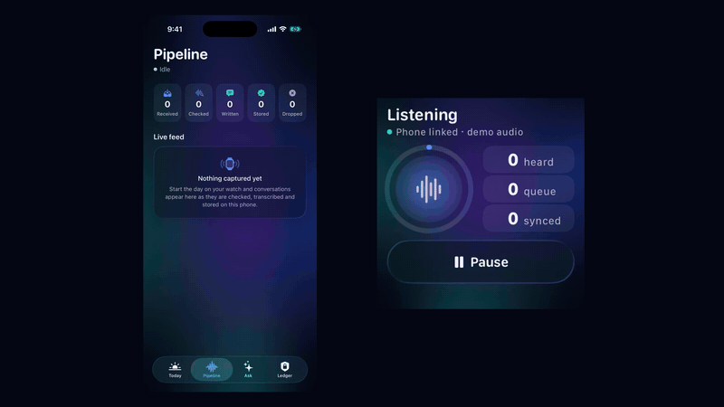
</p>

<p align="center">
  <a href="docs/media/echo-demo-preview.mp4"><b>▶ Watch the full-quality preview (MP4)</b></a>
  &nbsp;·&nbsp;
  <a href="docs/media/echo-demo-full.mp4"><b>▶ One continuous take, about 3 min (MP4)</b></a>
</p>

<p align="center"><sub>The watch replays a day, the phone checks, transcribes and indexes it, and then questions are answered: lookups on the phone, and the synthesis questions by <b>live Muse Spark</b> (<code>muse-spark-1.3</code>), with the exact text that was sent shown on screen. Everything in this preview was captured from the running app; regenerate it with <code>Tools/make_readme_media.sh</code>. The continuous take (the app performs the whole demo itself: lookups, a live Muse answer with its citations, commitments, name masking, review before sending, a question asked out loud on the phone and on the watch, the history of what was asked, the kill switch and the architecture sheet, with the ~70 s sync sped up 5x) comes from <code>Tools/record_demo_take.sh</code>.</sub></p>

## A tour of the screens

### Apple Watch

On a real watch the day's capture would run in the background, with no button at all. Here it is a recorded day, so the first screen is a proof of life. Swipe up to **ask**: tap the big mic and say a question, and the watch shows what it heard, then the answer (which can be read aloud). Four suggestions cover the usual questions, and **Recent** lists the last eight, each reopening without asking again.

<table align="center">
  <tr>
    <td align="center">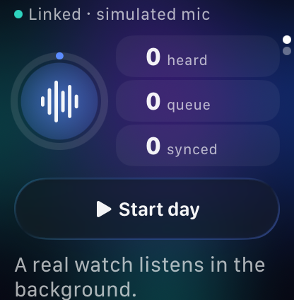<br><sub><b>Ready</b><br>A simulated microphone and a recorded day</sub></td>
    <td align="center">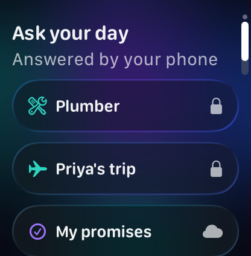<br><sub><b>Ask</b><br>Tap the mic and speak</sub></td>
    <td align="center">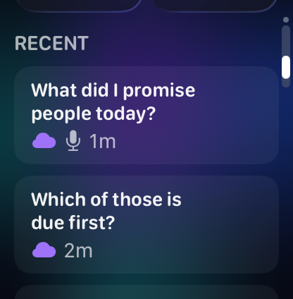<br><sub><b>Recent</b><br>Lock = on the phone, cloud = Muse</sub></td>
    <td align="center">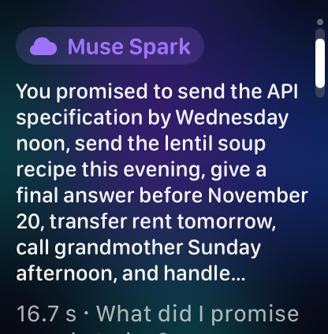<br><sub><b>An answer</b><br>To a spoken question, from Muse</sub></td>
  </tr>
</table>

### iPhone

A slim bar sits at the top of every tab: your profile, where you are, and indicators for the watch, the cloud and a lock that says everything stays on the phone. The profile is just a name and a colour kept on the phone; there is no account.

<table align="center">
  <tr>
    <td align="center" valign="top">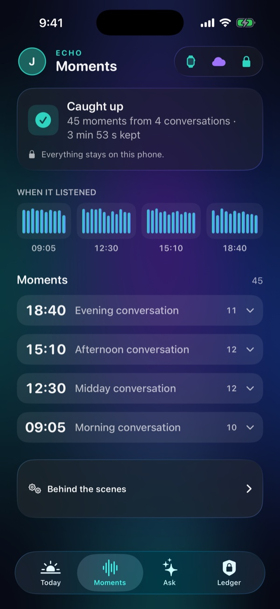<br><sub><b>Moments</b><br>What the phone heard, all on this phone</sub></td>
    <td align="center" valign="top">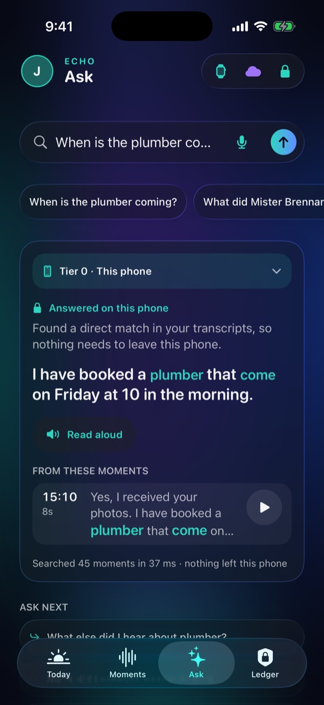<br><sub><b>Ask, locally</b><br>Highlighted words, source audio, about 30 ms</sub></td>
    <td align="center" valign="top">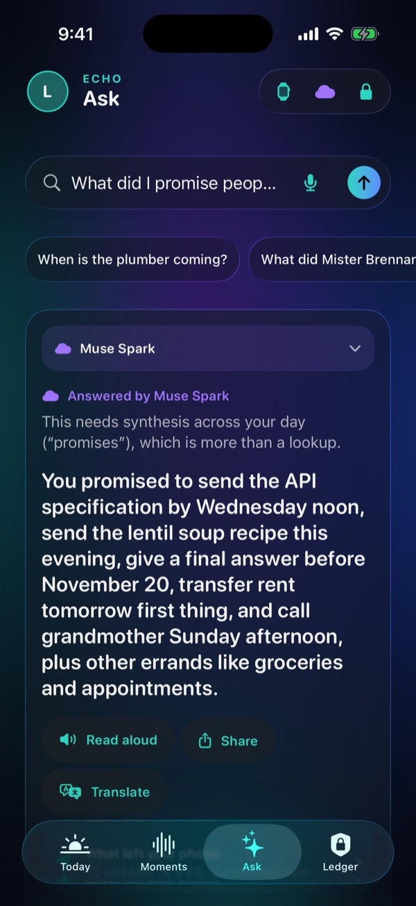<br><sub><b>Ask, with Muse</b><br>Live Muse Spark, with proof of what left the phone; Read aloud and Share</sub></td>
  </tr>
  <tr>
    <td align="center" valign="top">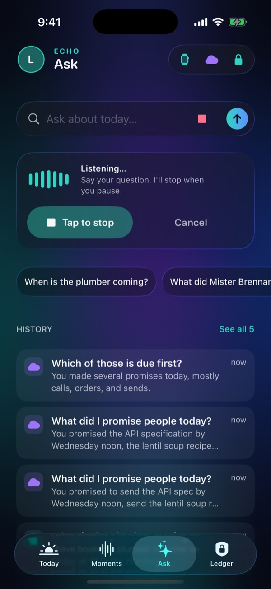<br><sub><b>Ask out loud</b><br>Understood on the phone; a recorded question stands in for the mic in the simulator</sub></td>
    <td align="center" valign="top">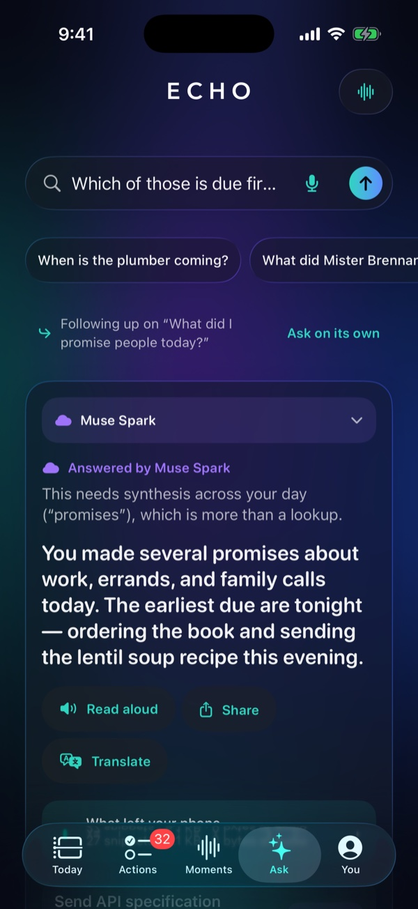<br><sub><b>Follow-ups</b><br>"Which of those is due first?" is sent with the earlier question, never the earlier answer</sub></td>
    <td align="center" valign="top">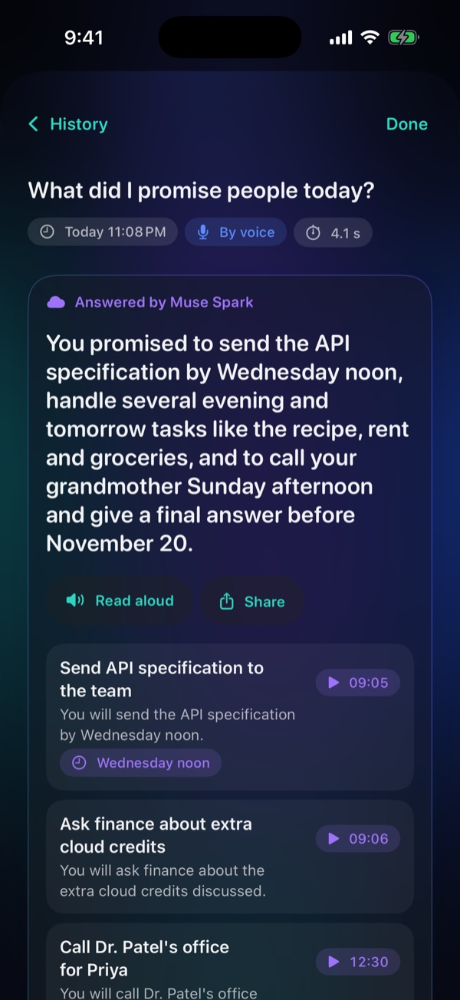<br><sub><b>History</b><br>Every question kept on the phone, with citations that still play</sub></td>
  </tr>
  <tr>
    <td align="center" valign="top">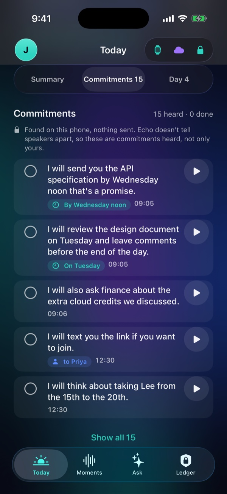<br><sub><b>Promises</b><br>Found with plain rules; the bell sets a reminder</sub></td>
    <td align="center" valign="top">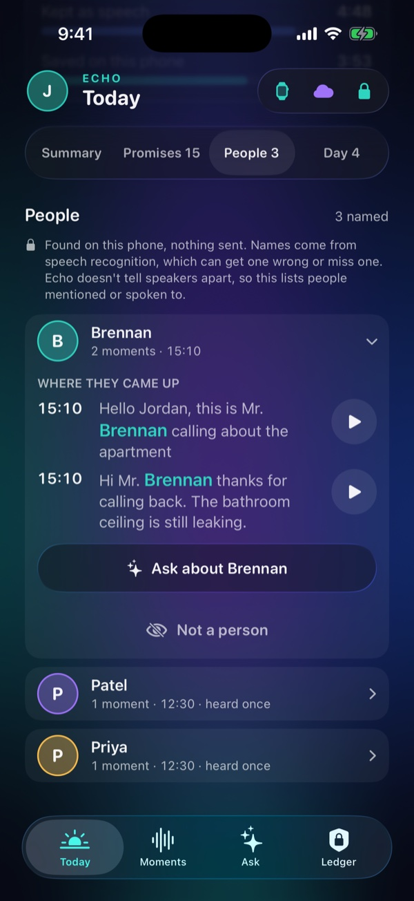<br><sub><b>People</b><br>Who came up, and where; misheard names can be hidden</sub></td>
    <td align="center" valign="top">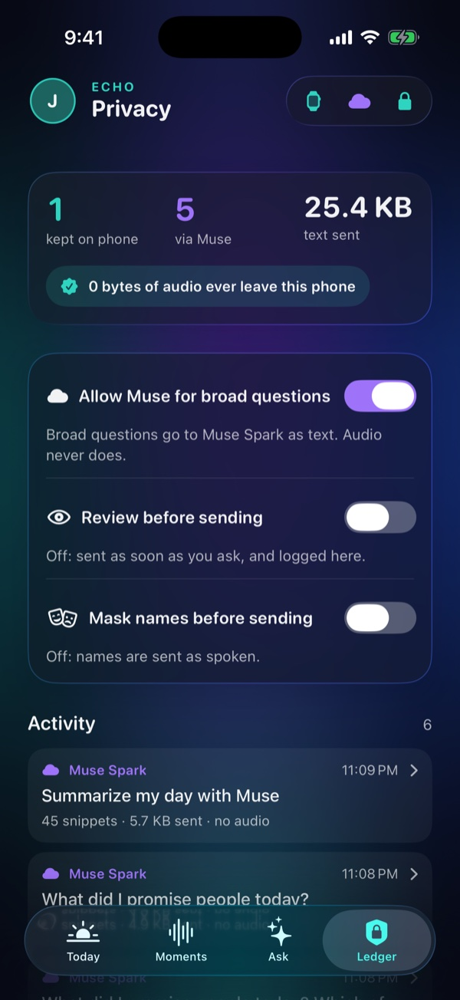<br><sub><b>Privacy ledger</b><br>What stayed, what left, and the switches</sub></td>
  </tr>
</table>

## What it does

1. **Watch.** Listens, keeps only speech (a lenient voice detector with a 2-second pre-roll so the first word is never clipped), compresses it and streams it to the phone.
2. **Phone, all on-device.** A second speech check (Apple SoundAnalysis) rejects what isn't speech, Apple's on-device recognizer transcribes it, and the text is indexed in SQLite (FTS5 keyword search plus word-vector similarity). The **Moments** tab shows what it heard in plain language (is it listening, has it caught up, the moments grouped by conversation); you can play any moment or delete it.
3. **Ask your day.** A rules-based router decides where each question is answered:
   - **Lookups** ("When is the plumber coming?") are answered on the phone in about 30 ms, with the matching words highlighted and the original audio one tap away.
   - **Synthesis** ("What did I promise people today?", "Summarize my day") goes to **Muse Spark** through the Meta Model API. Echo plans the smallest set of snippets the question needs, sends text only, and asks for a structured answer.
4. **Commitments.** Things people said they will do ("I will send the spec by Wednesday noon") are collected on the phone with plain rules, no model: a checklist with who and when where known, and the audio of each one tap away. Echo doesn't tell speakers apart, so it lists commitments heard, not only yours. A bell on each one sets a **reminder**: a local notification at the due time when Echo can place it ("Wednesday noon", "tomorrow morning"), in an hour, or tomorrow morning. It repeats the commitment on the lock screen, and Forget my day cancels every reminder.
5. **People.** Who the day mentions or speaks to, with the moments each name came up in (playable), the commitments that involve them, and a button to ask about them. Names come from the same on-device tagger as name masking, so a misheard word can slip in; "Not a person" hides it, and nothing is sent.
6. **Follow-up questions.** A short question that leans on the last one ("Which of those is due first?") is understood as a follow-up for ten minutes. Echo carries the earlier *question* along, never the earlier answer, so what is sent is exactly the combined text, which the review sheet and the ledger show. A line under the field says what it was a follow-up to, with "Ask on its own" to undo it.
7. **Citations you can hear.** Muse cites the snippets its answer comes from by label, and Echo maps each label back to the audio on the phone, so every claim plays its source. Answers suggest follow-up questions, and any answer or the day's summary can be **shared** as plain text through the system share sheet.
8. **Ask out loud, from the phone or the watch.** Tap the mic and say the question. It is understood on the phone with Apple's on-device recognizer (the recording is deleted straight away, and audio never goes to Muse), shown back to you as heard, then answered like any typed question. The watch has four suggestions too. Answers can be **read aloud**, and are read back automatically after a spoken question (a switch in your profile turns that off).
9. **History.** Every question and its answer is kept on the phone, newest first, with citations that still play, until you clear it. Open one to see it again, ask it again, or find it in the ledger. The watch shows the last eight. Forget my day removes the history too, and now also blanks Muse's replies in the ledger.
10. **Privacy ledger and controls.** Every question is recorded with where it was answered, the exact text and bytes sent, tokens and latency. You can turn the cloud off, **review each request before it is sent**, **mask people's names** (placeholders on the way out, real names on the way back), export the ledger as JSON, or forget the day.

## What's real, simulated, and design-only

| Part | Status |
|---|---|
| Voice detection on the watch, chunking, AAC compression, streaming to the phone | **Real** (running in the watchOS simulator) |
| Stage-2 speech check, on-device transcription, SQLite FTS5 + word-vector index, retriever, router, answers | **Real** |
| Muse Spark calls (structured output, text-only snippets, ledger, error handling) | **Real**: live calls to `muse-spark-1.3` through the Meta Model API (the screenshots above are live answers), plus a mocked-network test suite. Without an API key in `Config/meta_api_key.txt` Echo falls back to a **labeled offline stub** |
| The microphone | **Simulated**: a pre-recorded day (text-to-speech voices, 4 conversations) replayed as the mic. On a real watch this would be a background service, not a button |
| Spoken questions | **Real from the recording onward**: the question is captured with an endpointer, compressed, sent from the watch, understood on-device, answered and kept. **Simulated** at the start: in the simulators a recorded question stands in for the mic (labelled on screen). The real-microphone path is implemented but has not been tried on hardware |
| Watch ↔ phone link | **Simulated hardware**: WatchConnectivity messages between two simulators |
| Muse Glimmer on-device (Tier 1) | **Design only**: shown in the UI as not available, never run |

## Architecture


## Measured on the demo day

| | |
|---|---|
| Recorded → kept by the watch → confirmed on the phone | 6:15 → 4:48 → 3:53 (38% of the day never stored) |
| Stage 2 | 45 of 45 speech chunks kept, 11 of 11 noise chunks rejected (the noise is synthetic, so this flatters it) |
| Transcription word error rate | 7.2% overall (every scene under 10%) on text-to-speech voices; it will be worse on real speech |
| Retrieval | right moment ranked first for 12 of 12 questions; median search about 26 ms |
| Live Muse Spark (`muse-spark-1.3`) | "What did I promise people today?" about 5-6 s (27 snippets, 4.9 KB sent); "Summarize my day" about 6-7 s; the day digest about 10 s (45 snippets, about 5.9 KB) |
| Tests | 289 unit tests, including a retrieval and routing eval over a fixed transcript fixture, a mocked-network suite for the Muse client, and tests for commitments, citations, masking, the review gate, the watch's requests, spoken questions, the history and reading aloud; plus an end-to-end script (`Tools/e2e_check.sh`) that checks the whole demo against live Muse |

## The privacy model

- **Audio never leaves the phone.** The cloud client's request type holds text only, and a test asserts that no audio, file name or local identifier appears in the request body.
- **Only what a question needs is sent.** Commitments send the moments that contain promises or plans; a summary sends the day; a question that matches nothing sends nothing.
- **Everything is on the record.** The Privacy Ledger lists each question, which tier answered, and the exact snippets and bytes sent. Local answers are logged with zero bytes.
- **You are in control.** One switch turns the cloud off; those questions then show the closest moments on the phone. **Review before sending** holds each request behind a sheet that shows the exact text. **Mask names** swaps people's names for placeholders (`[PERSON_1]`) on the phone and restores them in the answer; it is best effort, relies on Apple's on-device name tagger, and is off by default because a misheard word that looks like a name is masked too. You can export the ledger as JSON (what was sent, never Muse's replies or your key) and **forget the day** at any time.
- **No hidden fallback.** If Muse can't be reached, Echo says so (key rejected, rate limited, timed out, offline: "nothing left your phone"). The offline stub only appears when no key exists, and it labels itself.

## How Echo uses Muse Spark

Echo calls `POST https://api.meta.ai/v1/chat/completions` with model `muse-spark-1.3`, a `developer` message with the rules, a `user` message with the question and time-labelled snippets, `reasoning_effort: "minimal"`, and a JSON-schema `response_format`. Snippets are labelled `S1`, `S2`… within the request (never the phone's own identifiers), and the answer comes back as structured data: an answer, items with a due date and the label of the snippet each came from, and follow-up questions. Echo maps each label back to the audio on the phone, so a citation plays its source. The prompt tells Muse that the transcripts are noisy speech recognition and to say so only when it actually corrected something. The same path produces the one-tap "Summarize my day" digest of conversations, action items and people.

Two things the live API taught us, both now handled and tested: **reasoning tokens count against `max_completion_tokens`** (at 800 tokens Muse spent 798 thinking and returned an empty reply, so Echo uses a 3000-token budget and retries once with double if a reply is cut off), and `minimal` reasoning answers the real questions in about 6 s versus 11 s at `low`. If the account can't use the model the client falls back to 1.2 then 1.1, and if structured output is refused it retries once with the schema in the instructions.

## Run it

Requirements: macOS with Xcode 26.1.1 and the iOS 26.1 and watchOS 26.1 simulators.

```bash
# 1. Pair a phone and a watch simulator (once) and put their IDs at the top of the scripts in Tools/
xcrun simctl list devices available
xcrun simctl pair <WATCH_UDID> <PHONE_UDID>

# 2. (Optional) add your Meta Model API key. Without it Echo uses its labeled offline stub.
#    Edit Config/meta_api_key.txt and replace the placeholder line. It is gitignored.

# 3. Build, install both apps and launch
Tools/run_sims.sh --autostart      # the watch starts replaying the day immediately
```

The first launch asks for speech-recognition permission on the phone; tap Allow once. Then open **Today**, **Moments**, **Ask** and **Ledger**.

| Script | What it does |
|---|---|
| `Tools/demo_prep.sh` | Clean, recordable simulators (9:41 status bar, dark mode, fresh day) |
| `Tools/e2e_check.sh` | Replays the day and checks the whole demo against ground truth (PASS/FAIL) |
| `Tools/muse_smoke.sh` | Checks your API key, model and region with one tiny call |
| `Tools/check_no_secrets.sh` | Fails if your key appears anywhere it could be published |
| `Tools/record_demo_take.sh` | Records one continuous, self-driving demo take of both simulators (live Muse if a key is set) |
| `Tools/make_readme_media.sh` | Regenerates the screenshots, video and GIF in this README |

```bash
# Unit tests
xcodebuild test -project Echo.xcodeproj -scheme Echo \
  -destination 'platform=iOS Simulator,name=iPhone 17 Pro' -only-testing:EchoTests
```

## Repo map

| Path | What's there |
|---|---|
| `Echo Watch App/` | Watch app: replay engine, uploader, status screen, the demo audio |
| `Echo/` | Phone app: receiver, processing pipeline, screens |
| `Echo/Moments/` | The Moments tab: status banner, ribbon, grouped moments, Behind the scenes |
| `Echo/Search/` | Normalizer, embeddings, hybrid retriever, router, answer extraction, commitments, citations |
| `Echo/Components/` | The shared UI parts: section headers, chips with wrapping layout, buttons, rows, segmented control |
| `Echo/Cloud/` | Muse client, planner and prompts, labeled stub, key handling |
| `Echo/Ledger/` | The privacy ledger and the cloud switch |
| `Echo/Voice/` | Spoken questions: the mic flow, on-device understanding, what the phone does for the watch |
| `Echo/History/` | The history of questions: storage, the list, the detail view |
| `Shared/` | Code shared by both apps: voice detector, question recorder, speaker, wire format, clock, theme |
| `EchoTests/` | Unit tests and the transcript fixture |
| `Tools/` | Demo audio generator, calibration, simulator, demo and media scripts |
| `docs/media/` | The screenshots, preview video, GIF and hero image above |

## Limitations and what's next

- The microphone is simulated; a real watch needs a foreground session and `AVAudioEngine`, and WatchConnectivity file transfer in place of the simulator's message transport.
- Muse Glimmer on-device (Tier 1) is a design, not an implementation.
- Retrieval uses averaged word vectors because sentence embeddings aren't available in the simulator; a sentence model would be the next upgrade. It does not use `sqlite-vec`.
- Transcription quality on real, noisy speech is untested.
- The router is rules, not a model; it is easy to explain and test, but a learned router could handle more phrasing.
- Echo doesn't identify speakers, so Commitments lists promises heard rather than only the wearer's.
- Name masking is best effort (it only masks names the on-device tagger recognizes) and is off by default.
- Asking from the watch (by voice or a suggestion) needs the phone reachable; a question that needs Muse waits for approval on the phone when Review before sending is on. Recent still opens from the watch's cache when the phone is away.
- Spoken questions: the microphone path (`AVAudioEngine`, on both devices) is written and shares the endpointer and the transcription with the recorded-question path, but only the recorded path has been run, because simulators have no microphone. Read aloud is untested on a real watch speaker.
- The history is kept until you clear it (it is on the phone only, never exported, and cleared by Forget my day); there is no search in it yet.
