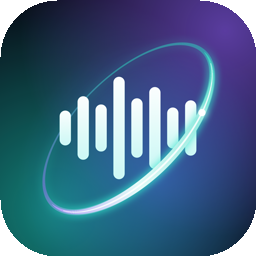
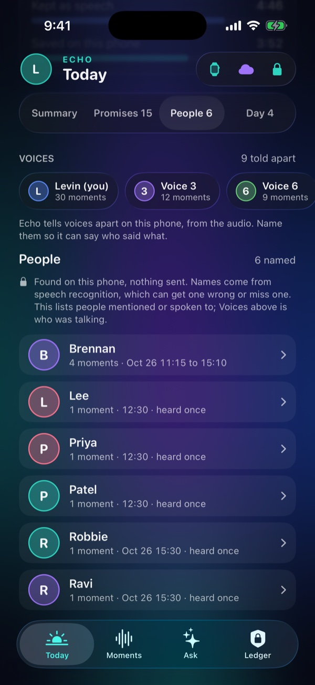
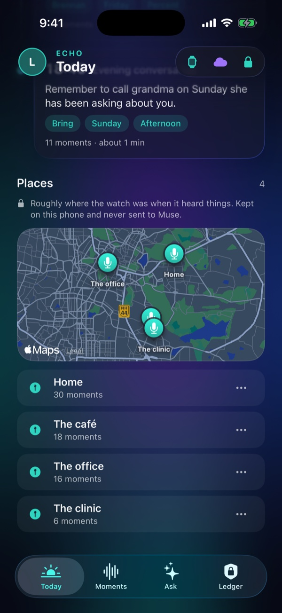
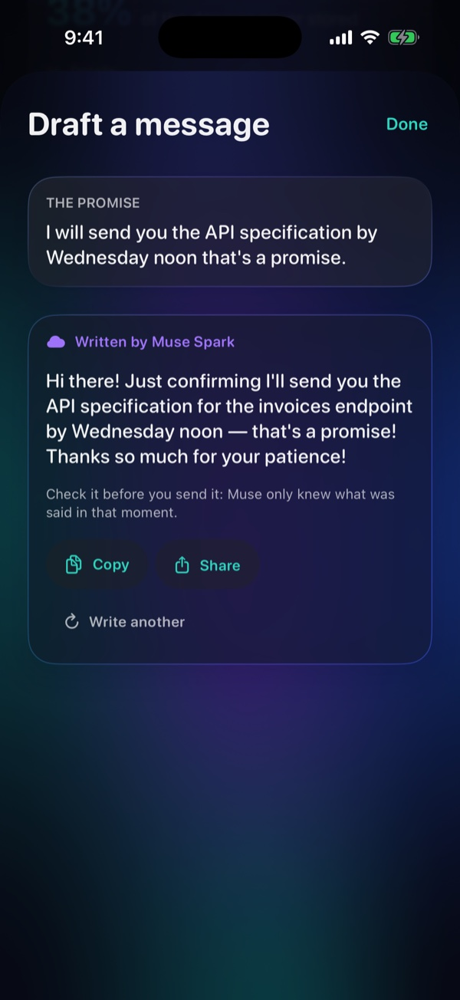
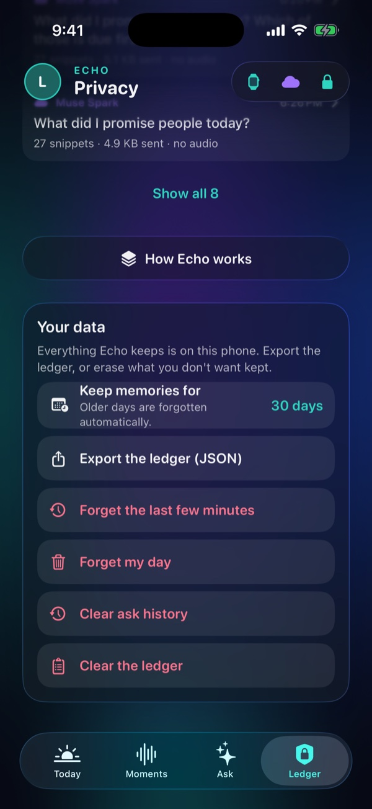
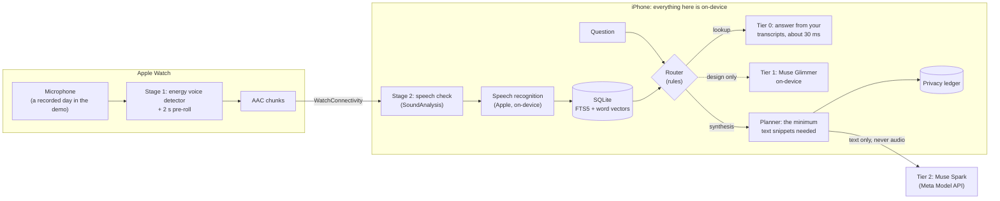

<div align="center">

<h1>&nbsp;Echo</h1>

### A private memory for your day

*Your watch listens. Your phone remembers, for weeks, not just a day. Meta's Muse Spark helps only when it has to.*


</div>

Echo turns a day of conversations into something you can ask questions of, **without handing your voice to anyone**. The speech is transcribed and searched on your phone. Only the rare question that needs real synthesis goes to **Meta's Muse Spark**, and when it does, Echo sends a handful of text snippets, never audio, and records exactly what left the device in a privacy ledger.

> **Demo setup.** The demo runs the watch and phone apps in Xcode simulators, with a recorded day of conversations fed through the same pipeline a live microphone would use. Everything after the microphone is the real code path. What has and has not been run on hardware is listed in [Verified, and next steps](#verified-and-next-steps).

## See it work

<p align="center">
  
</p>

<p align="center">
  <a href="docs/media/echo-demo-preview.mp4"><b>▶ Watch the full-quality preview (MP4)</b></a>
  &nbsp;·&nbsp;
  <a href="docs/media/echo-demo-full.mp4"><b>▶ One continuous take, about 4½ min (MP4)</b></a>
</p>

<p align="center"><sub>The watch replays a day, the phone checks, transcribes and indexes it, and then questions are answered: lookups on the phone, and the synthesis questions by <b>live Muse Spark</b> (<code>muse-spark-1.3</code>), with the exact text that was sent shown on screen. Everything in this preview was captured from the running app. The continuous take covers last week's day and today's, lookups across days, a live Muse answer with its citations, commitments, a drafted message, voices and places, name masking, review before sending, a question asked out loud on the phone and on the watch, the history of what was asked, forgetting the last ten minutes, the kill switch and the architecture sheet, with the sync of both days sped up 5x.</sub></p>

## A tour of the screens

### Apple Watch

On a watch, capture runs in the background with no button at all; in the demo the first screen shows it working. Swipe up to **ask**: tap the big mic and say a question, and the watch shows what it heard, then the answer (which can be read aloud). Four suggestions cover the usual questions, and **Recent** lists the last eight, each reopening without asking again.

<table align="center">
  <tr>
    <td align="center"><br><sub><b>Ready</b><br>Capture, with a live level and counters</sub></td>
    <td align="center"><br><sub><b>Ask</b><br>Tap the mic and speak</sub></td>
    <td align="center"><br><sub><b>Recent</b><br>Lock = on the phone, cloud = Muse</sub></td>
    <td align="center"><br><sub><b>An answer</b><br>To a spoken question, from Muse</sub></td>
  </tr>
</table>

### iPhone

A slim bar sits at the top of every tab: your profile, where you are, and indicators for the watch, the cloud and a lock that says everything stays on the phone. The profile is just a name and a colour kept on the phone; there is no account.

<table align="center">
  <tr>
    <td align="center" valign="top"><br><sub><b>Moments</b><br>What the phone heard, all on this phone</sub></td>
    <td align="center" valign="top"><br><sub><b>Ask, locally</b><br>Highlighted words, source audio, about 30 ms</sub></td>
    <td align="center" valign="top"><br><sub><b>Ask, with Muse</b><br>Live Muse Spark, with proof of what left the phone; Read aloud and Share</sub></td>
  </tr>
  <tr>
    <td align="center" valign="top"><br><sub><b>Ask out loud</b><br>Understood on the phone, then answered like any typed question</sub></td>
    <td align="center" valign="top"><br><sub><b>Follow-ups</b><br>"Which of those is due first?" is sent with the earlier question, never the earlier answer</sub></td>
    <td align="center" valign="top"><br><sub><b>History</b><br>Every question kept on the phone, with citations that still play</sub></td>
  </tr>
  <tr>
    <td align="center" valign="top"><br><sub><b>Promises</b><br>Found with plain rules; the bell sets a reminder</sub></td>
    <td align="center" valign="top"><br><sub><b>People</b><br>Who came up, and where; misheard names can be hidden</sub></td>
    <td align="center" valign="top"><br><sub><b>Privacy ledger</b><br>What stayed, what left, and the switches</sub></td>
  </tr>
</table>

And what Echo does with more than one day, more than one voice and more than one place:

<table align="center">
  <tr>
    <td align="center" valign="top"><br><sub><b>Voices</b><br>Told apart on the phone; name them, mark which is you</sub></td>
    <td align="center" valign="top"><br><sub><b>Places</b><br>Coarse locations you name yourself; never looked up, never sent</sub></td>
    <td align="center" valign="top"><br><sub><b>Draft the message</b><br>Only the promise and the line before it go to Muse, through the same review gate</sub></td>
  </tr>
  <tr>
    <td align="center" valign="top"><br><sub><b>Your data</b><br>How long to keep memories, forget the last minutes, announce recording</sub></td>
  </tr>
</table>

## What it does

1. **Watch.** Listens, keeps only speech (a lenient voice detector with a 2-second pre-roll so the first word is never clipped), compresses it and streams it to the phone.
2. **Phone, all on-device.** A second speech check (Apple SoundAnalysis) rejects what isn't speech, Apple's on-device recognizer transcribes it, and the text is indexed in SQLite (FTS5 keyword search plus word-vector similarity). The **Moments** tab shows what it heard in plain language (is it listening, has it caught up, the moments grouped by conversation); you can play any moment or delete it.
3. **Ask your day.** A rules-based router decides where each question is answered:
   - **Lookups** ("When is the plumber coming?") are answered on the phone in about 30 ms, with the matching words highlighted and the original audio one tap away.
   - **Synthesis** ("What did I promise people today?", "Summarize my day") goes to **Muse Spark** through the Meta Model API. Echo plans the smallest set of snippets the question needs, sends text only, and asks for a structured answer.
4. **Commitments.** Things people said they will do ("I will send the spec by Wednesday noon") are collected on the phone with plain rules, no model: a checklist with who and when where known, and the audio of each one tap away. It lists everything heard, with a Mine / Everyone filter once it knows which voice is yours. A bell on each one sets a **reminder**: a local notification at the due time when Echo can place it ("Wednesday noon", "tomorrow morning"), in an hour, or tomorrow morning. It repeats the commitment on the lock screen, and Forget my day cancels every reminder.
5. **People.** Who the day mentions or speaks to, with the moments each name came up in (playable), the commitments that involve them, and a button to ask about them. Names come from the same on-device tagger as name masking, so a misheard word can slip in; "Not a person" hides it, and nothing is sent.
6. **Follow-up questions.** A short question that leans on the last one ("Which of those is due first?") is understood as a follow-up for ten minutes. Echo carries the earlier *question* along, never the earlier answer, so what is sent is exactly the combined text, which the review sheet and the ledger show. A line under the field says what it was a follow-up to, with "Ask on its own" to undo it.
7. **Citations you can hear.** Muse cites the snippets its answer comes from by label, and Echo maps each label back to the audio on the phone, so every claim plays its source. Answers suggest follow-up questions, and any answer or the day's summary can be **shared** as plain text through the system share sheet.
8. **Ask out loud, from the phone or the watch.** Tap the mic and say the question. It is understood on the phone with Apple's on-device recognizer (the recording is deleted straight away, and audio never goes to Muse), shown back to you as heard, then answered like any typed question. The watch has four suggestions too. Answers can be **read aloud**, and are read back automatically after a spoken question (a switch in your profile turns that off).
9. **History.** Every question and its answer is kept on the phone, newest first, with citations that still play, until you clear it. Open one to see it again, ask it again, or find it in the ledger. The watch shows the last eight. Forget my day removes the history too, and now also blanks Muse's replies in the ledger.
10. **Privacy ledger and controls.** Every question is recorded with where it was answered, the exact text and bytes sent, tokens and latency. You can turn the cloud off, **review each request before it is sent**, **mask people's names** (placeholders on the way out, real names on the way back), export the ledger as JSON, or forget the day.

11. **Memory across days.** Each day is kept as its own day (30 days by default; 7, 90 or forever in the You tab). Ask about any of them ("How much was the rent increase last week?", "What did the dentist say on Tuesday?"); with no day named, the newest fact wins, so a figure that was updated since still answers correctly. The Day tab shows "a week ago today", and "Summarize my past week" is one Muse call over the saved daily summaries.
12. **Voices.** The phone tells voices apart from the audio alone (a pure-Swift voiceprint, no model download), lets you name them and mark "This is me", and uses it where it matters: Promises has a Mine / Everyone filter, and "What did I promise?" is answered from your own voice only.
13. **Where it happened.** Each moment is stamped with a coarse location (about 100 m). Name a place ("Home", "The office") and ask "Where was I when I promised that?"; a map shows the day. Places can be marked **never record**. There is no reverse geocoding, so nothing is looked up anywhere.
14. **Privacy controls.** Say "this is off the record" and Echo keeps nothing until you say "back on the record" (or ten minutes pass): what is said in between is understood only long enough to hear the way back, then thrown away. **Forget the last 5, 10, 30 or 60 minutes** from the phone or the wrist; it removes the moments, their audio, their search entries, the history that cited them and the reminders for their promises. The watch can announce that it is listening (a buzz every ten minutes).
15. **Catching things as they happen.** A promise you make appears on the watch as "Got it" with Keep / Dismiss (or as a notification with a "Remind me" button), a bell can also add it to **Calendar**, and "Draft the message" writes the follow-up from only that moment and the line before it, through the same review gate and ledger. Decisions ("we decided to go with the second vendor") are listed, and "Why did we...?" finds them. Before a meeting with someone Echo knows, a **briefing** says when you last spoke and what is owed either way. Each evening it can offer to write the day up as a journal entry.
16. **Hey Echo.** A snippet that opens with "Hey Echo" is a command: the rest is answered on the watch and the command itself is never kept in memory.
17. **Siri, Shortcuts, widgets.** "Ask Echo ...", "What did I promise in Echo", "Forget the last few minutes in Echo" (App Intents), a Promises widget for the Home and Lock Screen, a watch complication, and a Live Activity for a promise that is coming due.
18. **On this phone, and in your language.** When Apple's on-device model is available, synthesis questions can be answered by it instead of Muse (a switch in the You tab; the same minimal snippets, never sent, logged as "On-device model"), and any answer or moment can be translated on the device.
19. **Actions.** A fifth tab turns what was said into things to do, found on the phone with plain rules: calendar events (a plumber on Friday at ten, a birthday every year), emails and messages (the document you promised, the recipe you said you would send), calls, shopping lists, to-dos, and what other people owe you. Each card shows the words it came from, with the audio, and a button for what it needs. Opening one shows a **draft you can edit inside Echo**: the phone writes a first version instantly, Muse (when it is on) writes a better one, and one tap opens it in Mail, Messages or WhatsApp with the recipient, subject and text filled in. Events and reminders are added straight to Calendar and Reminders (with a clash check against your calendar), and Contacts are read on the phone only to fill in the address or number. "Find more with Muse" looks for the subtler ones, behind the same review gate and ledger. Everything dealt with is kept in a Done list you can move back from, and an optional 8 am summary says how many are waiting.
20. **Nothing confidential leaves the phone.** Before any request to Muse (a question, a digest, a draft, the Actions search), the phone scans the text for passwords, PINs and one-time codes, card numbers (Luhn-checked), account and ID numbers, keys and tokens, email addresses and phone numbers, and swaps each for a placeholder such as `[PASSWORD_1]`. Muse never sees the value. In a draft the real value is put back **on the phone only**, so the message you edit reads naturally; answers, summaries, history, the ledger and its export keep the placeholder. Rules, not a model, so it adds almost no time; it errs towards hiding more, the review sheet shows exactly what would be sent, and the ledger records how many details were held back, never what they were.
21. **When to listen, from the watch or the phone.** The watch's main screen is one big button and one line ("Tap to listen", "Listening"), with a small chip for when: **only when I tap**, **all day**, or **set hours**. The same choice is on the phone (Moments and You) and the two stay in step, the newest change winning. The numbers (heard, waiting to send, sent) are still tracked but live behind a "More" page on the watch, next to forgetting the last ten minutes. A watch cannot open its microphone by itself in the background, so for all day and set hours Echo **nudges you at the start time** ("Time to start listening?", one tap), stops by itself at the end of the hours, carries on if something interrupts it, and stops below 20% battery.

## Verified, and next steps

| Part | Status |
|---|---|
| Voice detection on the watch, chunking, AAC compression, streaming to the phone | **Verified** end to end (watchOS and iOS simulators) |
| Stage-2 speech check, on-device transcription, SQLite FTS5 + word-vector index, retriever, router, answers | **Verified** end to end |
| Muse Spark calls (structured output, text-only snippets, ledger, error handling) | **Verified**: live calls to `muse-spark-1.3` through the Meta Model API (the screenshots above are live answers), plus a mocked-network test suite. Without an API key in `Config/meta_api_key.txt` Echo falls back to a labeled offline stub |
| Capture source | The demo feeds two recorded days (last week's and today's) through the same voice detector a live microphone uses. The live microphone path and all-day background capture are implemented and **not yet run on hardware** |
| Spoken questions | **Verified** from the recording onward: the question is captured with an endpointer, compressed, sent from the watch, understood on-device, answered and kept. The real-microphone path is implemented and not yet tried on hardware |
| Memory across days, voices, places, off the record, forget-last-minutes, promises caught as they are said, drafts, decisions, journal, briefings, "Hey Echo" | **Verified** end to end (unit tests plus an end-to-end check of both days) |
| Speaker recognition | **Verified** on the demo recordings (eight voices come out as eight, about 96% of lines under the right voice, after the watch's compression). Not yet checked on real conversations, where short, noisy, overlapping speech is harder |
| Apple's on-device model for answers (Tier 1) | Implemented and tested with a stand-in model; the model's assets are not installed in the simulator, so Echo uses Muse as before. Needs a device that supports Apple Intelligence |
| Live microphone and background capture on the watch (`AVAudioEngine`, a workout session that keeps the app running and saves nothing) | Implemented, **not yet run on hardware** |
| "Hey Echo" | The wake phrase is recognised from what the phone transcribes, and that is **verified** end to end; on a real microphone it is not yet verified (and it only works while Echo is listening) |
| Siri and Shortcuts, widgets, watch complication, Live Activity | Built and unit-tested (the intents' answers, the shared snapshot); how they look on a Home Screen, a watch face and the Dynamic Island is not yet verified |
| Listening modes, the nudge at the start of the hours, low-battery stop, resume after an interruption | The rules are unit-tested (`ListeningPlan`), and the watch and phone screens were run in the simulators. The real watch microphone, the start-of-hours notification on a watch and the battery stop are **not yet run on hardware** |
| Notifications and Calendar events | Scheduling and calendar writes are tested; a real notification firing and a real calendar are not yet verified |
| Actions: finding, drafts, hand-offs | **Verified** on the demo day (unit tests, and the page run in the simulator with live Muse drafts). iOS never lets an app send an email, text or WhatsApp message by itself, so one tap opens the app with the draft filled in and you press Send there; Mail, Messages and WhatsApp composers, real Contacts, and adding to Reminders were not run on a physical phone |
| Confidential details held back | **Verified** live: a seeded moment with a password, card number and phone number was drafted with Muse; the request and the ledger held only `[PASSWORD_1]`, `[CARD_1]`, `[PHONE_1]`, and the password came back only in the draft on screen |
| Watch ↔ phone link | **Verified** with WatchConnectivity between the paired simulators; not yet on a paired watch |

## Architecture



## Measured on the demo day

| | |
|---|---|
| Recorded → kept by the watch → confirmed on the phone | 6:15 → 4:48 → 3:53 (38% of the day never stored) |
| Stage 2 | 45 of 45 speech chunks kept, 11 of 11 noise chunks rejected (the noise in the demo day is simple, so this flatters it) |
| Transcription word error rate | 7.4% overall (every scene under 10%) on the demo recordings; real speech will be harder |
| Retrieval | right moment ranked first for 12 of 12 questions; median search about 26 ms |
| Live Muse Spark (`muse-spark-1.3`) | "What did I promise people today?" about 5-6 s (27 snippets, 4.9 KB sent); "Summarize my day" about 6-7 s; the day digest about 10 s (45 snippets, about 5.9 KB) |
| Tests | 562 unit tests, including a retrieval and routing eval over a fixed transcript fixture, a mocked-network suite for the Muse client, and tests for the actions page (finding, drafts, hand-offs, what never leaves the phone), commitments, citations, masking, the review gate, the watch's requests, spoken questions, the history and reading aloud, memory across days, voices (clustered against the demo's known speakers), places, off the record, the wake word, drafts, briefings, the Siri intents and the widget snapshot; plus an end-to-end script (40 checks, including those) that checks the whole demo against live Muse |

## The privacy model

- **Audio never leaves the phone.** The cloud client's request type holds text only, and a test asserts that no audio, file name or local identifier appears in the request body.
- **Only what a question needs is sent.** Commitments send the moments that contain promises or plans; a summary sends the day; a question that matches nothing sends nothing.
- **Everything is on the record.** The Privacy Ledger lists each question, which tier answered, and the exact snippets and bytes sent. Local answers are logged with zero bytes.
- **You are in control.** One switch turns the cloud off; those questions then show the closest moments on the phone. **Review before sending** holds each request behind a sheet that shows the exact text. **Mask names** swaps people's names for placeholders (`[PERSON_1]`) on the phone and restores them in the answer; it is best effort, relies on Apple's on-device name tagger, and is off by default because a misheard word that looks like a name is masked too. You can export the ledger as JSON (what was sent, never Muse's replies or your key) and **forget the day** at any time.
- **Confidential details never leave.** Passwords, codes, card and account numbers, ID numbers, keys, emails and phone numbers are found on the phone and replaced with placeholders in **every** request, with no switch to forget. They are put back only inside a draft you are editing on the phone. It is rule-based and best effort: an unusual way of saying a secret can slip past, so the review sheet shows exactly what would be sent.
- **No hidden fallback.** If Muse can't be reached, Echo says so (key rejected, rate limited, timed out, offline: "nothing left your phone"). The offline stub only appears when no key exists, and it labels itself.

## How Echo uses Muse Spark

Echo calls `POST https://api.meta.ai/v1/chat/completions` with model `muse-spark-1.3`, a `developer` message with the rules, a `user` message with the question and time-labelled snippets, `reasoning_effort: "minimal"`, and a JSON-schema `response_format`. Snippets are labelled `S1`, `S2`… within the request (never the phone's own identifiers), and the answer comes back as structured data: an answer, items with a due date and the label of the snippet each came from, and follow-up questions. Echo maps each label back to the audio on the phone, so a citation plays its source. The prompt tells Muse that the transcripts are noisy speech recognition and to say so only when it actually corrected something. The same path produces the one-tap "Summarize my day" digest of conversations, action items and people.

Two things the live API taught us, both now handled and tested: **reasoning tokens count against `max_completion_tokens`** (at 800 tokens Muse spent 798 thinking and returned an empty reply, so Echo uses a 3000-token budget and retries once with double if a reply is cut off), and `minimal` reasoning answers the real questions in about 6 s versus 11 s at `low`. If the account can't use the model the client falls back to 1.2 then 1.1, and if structured output is refused it retries once with the schema in the instructions.

## Long-term memory, and why Echo doesn't embed a memory engine

Echo's memory is SQLite on the phone: days of transcripts, an FTS5 index, word vectors, voices and places. We looked at open-source memory layers (Supermemory is MIT-licensed, so shipping it would be allowed) and decided against embedding one: it is a TypeScript, Cloudflare and Postgres service with no Swift SDK, its local mode is a separate server that needs its own embedding model and LLM, and a companion server would break "nothing leaves the phone". The useful ideas were rebuilt natively instead, with nothing copied: facts carry their day and the newest wins, each person has a page that persists across days, and old moments resurface ("a week ago today").

## Run it

Requirements: macOS with Xcode 26.1.1 and the iOS 26.1 and watchOS 26.1 simulators.

1. Open `Echo.xcodeproj` in Xcode and run the **Echo** scheme on an iPhone simulator, and the **Echo Watch App** scheme on a paired watch simulator (Xcode's *Window > Devices and Simulators* pairs them).
2. (Optional) add your Meta Model API key: edit `Config/meta_api_key.txt`, replace the placeholder line, then run `Tools/set_api_key.sh`. The file is gitignored. Without a key Echo uses its labeled offline stub.
3. On the watch, tap the big microphone button (in the simulator it replays the recorded day).

The first launch asks for speech-recognition permission on the phone; tap Allow once. Then open **Day**, **Actions**, **Moments**, **Ask** and **You**.

| Script | What it does |
|---|---|
| `Tools/set_api_key.sh` | Installs your key from `Config/meta_api_key.txt` into the app (never into the repo) |
| `Tools/muse_smoke.sh` | Checks your API key, model and region with one tiny call |
| `Tools/check_no_secrets.sh` | Fails if your key appears anywhere it could be published |

```bash
# Unit tests
xcodebuild test -project Echo.xcodeproj -scheme Echo \
  -destination 'platform=iOS Simulator,name=iPhone 17 Pro' -only-testing:EchoTests
```

## Repo map

| Path | What's there |
|---|---|
| `Echo Watch App/` | Watch app: replay engine, uploader, status screen, the demo audio |
| `Echo/` | Phone app: receiver, processing pipeline, screens |
| `Echo/Moments/` | The Moments tab: status banner, ribbon, grouped moments, Behind the scenes |
| `Echo/Search/` | Normalizer, embeddings, hybrid retriever, router, answer extraction, commitments, citations |
| `Echo/Components/` | The shared UI parts: section headers, chips with wrapping layout, buttons, rows, segmented control |
| `Echo/Cloud/` | Muse client, planner and prompts, labeled stub, key handling |
| `Echo/Ledger/` | The You tab: your profile, every switch, the privacy ledger and your data |
| `Echo/Voice/` | Spoken questions: the mic flow, on-device understanding, what the phone does for the watch |
| `Echo/History/` | The history of questions: storage, the list, the detail view |
| `Echo/Days/`, `Echo/Search/DayScope.swift` | Memory across days: day ids, retention, resurfacing, "last week" style scoping |
| `Echo/Speakers/` | Voiceprints (MFCC and pitch, pure Swift), the voice book, voice chips |
| `Echo/Privacy/` | Off the record, forget the last minutes, the recording announcement |
| `Echo/Proactive/` | Promises caught as they are said, drafts, the journal, briefings |
| `Echo/Actions/` | The Actions tab: finding things to do, the cards and editors, drafts, Calendar, Reminders, Contacts and the hand-offs |
| `Echo/Places/` | Coarse places, the map, "where was I" |
| `Echo/Brain/` | The on-device model behind a protocol |
| `Echo/Intents/`, `Echo/Widgets/` | Siri and Shortcuts, and what feeds the widgets |
| `EchoWidgets/`, `EchoWatchWidgets/`, `WidgetShared/` | The widget and Live Activity extension, the watch complication, the snapshot they share |
| `Shared/` | Code shared by both apps: voice detector, question recorder, speaker, wire format, clock, theme |
| `EchoTests/` | Unit tests and the transcript fixture |
| `Tools/` | Key setup, the Muse smoke test and the secrets check |
| `docs/media/` | The screenshots, preview video, GIF and hero image above |

## Limitations and what's next

- The live microphone path, the workout session that keeps the watch app running, and the move to WatchConnectivity file transfer for a day's audio are written for hardware but have only been built, not run.
- Apple's on-device model (Tier 1) is wired in and tested with a stand-in model; it cannot run in a simulator, so its answers have not been seen.
- Retrieval uses averaged word vectors because sentence embeddings aren't available in the simulator; a sentence model would be the next upgrade. It does not use `sqlite-vec`.
- Transcription quality on real, noisy speech has not been measured.
- The router is rules, not a model; it is easy to explain and test, but a learned router could handle more phrasing.
- Voiceprints are computed from short chunks with a small hand-built feature set (MFCCs and pitch). They separate the demo's eight voices well; similar real voices will be harder, and a neural speaker model can replace it behind the same interface.
- Name masking is best effort (it only masks names the on-device tagger recognizes) and is off by default.
- Asking from the watch (by voice or a suggestion) needs the phone reachable; a question that needs Muse waits for approval on the phone when Review before sending is on. Recent still opens from the watch's cache when the phone is away.
- Spoken questions: the microphone path (`AVAudioEngine`, on both devices) is written and shares the endpointer and the transcription with the recorded-question path, but only the recorded path has been run. Read aloud has not been tried on a real watch speaker.
- Actions are found with rules, so unusual phrasing is missed and a bare "it" ("I will transfer it") keeps its quote but not its subject; "Find more with Muse" covers some of that. Sending is always yours: Echo opens the draft in the right app, it never sends for you.
- The confidential-details scanner is rules, not a model; it catches well-formed passwords, codes and numbers reliably and can miss an odd phrasing.
- The history is kept until you clear it (it is on the phone only, never exported, and cleared by Forget my day); there is no search in it yet.
